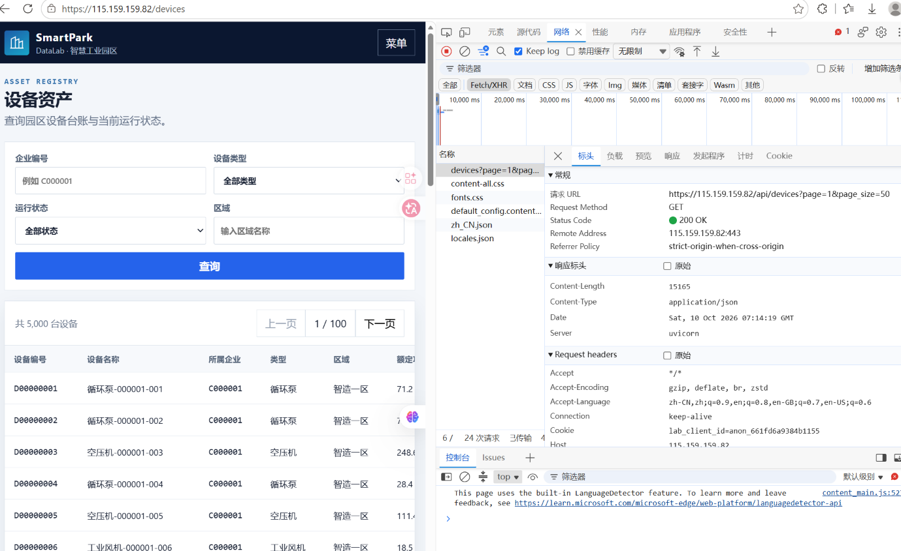
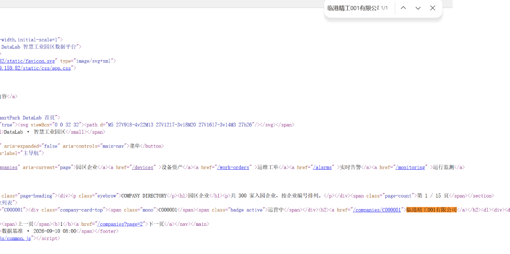
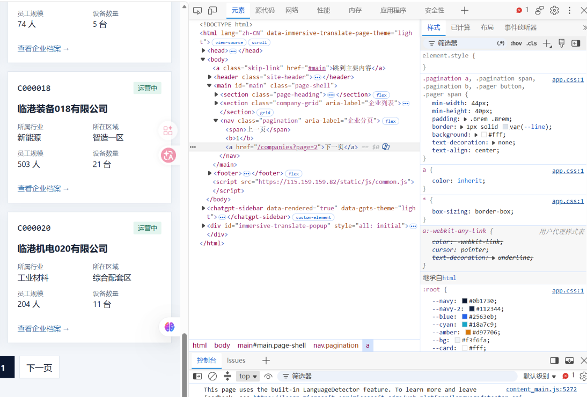
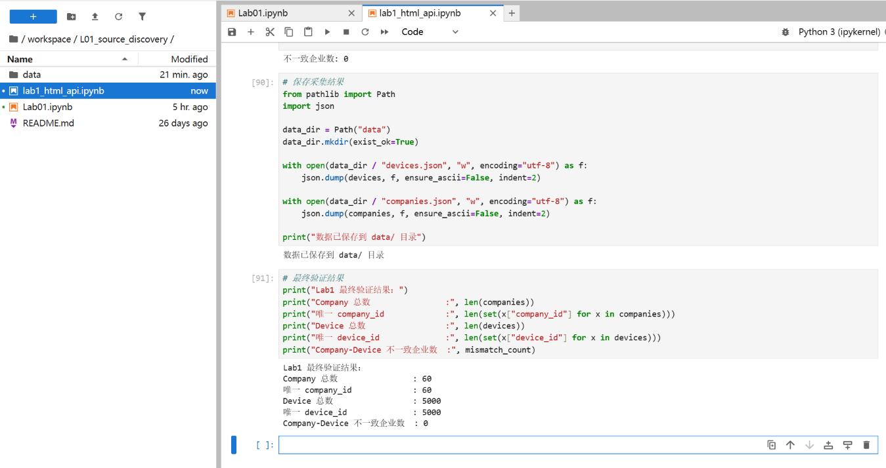

# Lab 1 实验报告

## 学生信息

- **姓名：刘嘉**
- **学号：112404260113**
- **班级：数据科学与大数据技术1241班**
- **GitHub 用户名：rxxy06**
- **仓库地址：<https://github.com/rxxy06/bigdata-collection-labs-112404260113>**

> 文件位置：`lab01/REPORT.md`
>   
> 完整代码保存在 `lab1_html_api.ipynb`。
>   
> 本报告只填写关键发现、关键代码、结果和指定截图，**不把整份 Notebook 复制进来**。

---

# 任务 1：判断数据加载方式

## 1.1 Device：判断动态加载并找到 API

### 判断结果

- 页面：`/devices`
- 数据加载方式：`动态加载`

### 判断依据

1. 在“查看网页源代码”中不能搜索到页面上的设备名称（例如 `循环泵-000001-001`），说明设备记录不随初始 HTML 一起返回；
2. 在 Network 的 Fetch/XHR 中能找到返回设备数据的请求（`/api/devices`），页面上的设备列表由该接口返回的 JSON 渲染。

### API 信息

- Request URL：`https://115.159.159.82/api/devices?page=1&page_size=50`
- Request Method：`GET`
- Query 参数：
  - `page`：1
  - `page_size`：50

### 【截图 1】Device API 发现证据

文件名：

```text
images/01_device_api.png
```

**截图内容必须是浏览器 DevTools，不是 Jupyter 代码。**

截图中应能看清：

1. 浏览器的 **Network** 面板；
2. 已选中真正返回设备列表的 Fetch/XHR 请求；
3. 右侧 **Headers** 中的 Request URL；
4. Query String Parameters（或 URL 中的分页参数）。

插入：



---

## 1.2 Company：判断静态加载

- 页面：`/companies`
- 数据加载方式：`静态加载`

### 判断依据

使用“右键 → 查看网页源代码”后，按 `Ctrl + F` 搜索页面中真实显示的企业名称（例如 `临港精工001有限公司`），**能够直接搜索到**。
  
这说明企业记录随初始 HTML 一起返回，不需要再发异步请求，因此按静态页面处理：`requests` → HTML → `BeautifulSoup` → CSS Selector。

### 【截图 2】Company 静态加载证据

文件名：

```text
images/02_company_source.png
```

**截图内容必须是“查看网页源代码”页面，不是 Elements，也不是 Jupyter。**

截图中应能看清：

1. 浏览器正在显示 `/companies` 的网页源代码；
2. 使用 `Ctrl + F` 搜索一个页面中真实存在的企业名称；
3. 源代码中能看到该企业名称或对应企业记录。

插入：



---

# 任务 2：Device API 分页采集

## 2.1 API 分页结构

| 含义   | JSON 字段     | 本次取值 |
| ---- | ----------- | ---: |
| 当前页  | `page`      |    1 |
| 每页条数 | `page_size` |   50 |
| 设备总数 | `total`     | 5000 |
| 设备列表 | `items`     |   50 |

---

## 2.2 关键代码

```python
# 从第一页响应中读取分页信息
total = data["total"]
page_size = data["page_size"]

total_pages = (total + page_size - 1) // page_size

devices = []

for page in range(1, total_pages + 1):
    r = requests.get(
        api_url,
        params={
            "page": page,
            "page_size": page_size
        },
        timeout=10
    )

    page_data = r.json()
    page_items = page_data["items"]
    devices.extend(page_items)
```

---

## 2.3 采集结果

- 每页条数：50
- 设备总数：5000
- 程序计算得到的总页数：100
- 最终采集设备数：5000
- 唯一 `device_id` 数：5000

回答：

> 为什么总页数应由 API 返回的 `total` 和 `page_size` 计算，而不是直接在代码里写死？

答：一是数据量会变化，写死页数后一旦服务端新增或删减数据，就会漏采或多发无效请求；二是页数本身是接口响应给出的信息，
  
`total` 与 `page_size` 用 `(total + page_size - 1) // page_size` 计算可以自动适应任何数据量。
  
另外，如果只采集 `range(1, 101)` 这样写死的页数，代码就失去了通用性，换一个数据集必须重新改代码。

---

# 任务 3：Company HTML 解析

## 3.1 企业记录 Selector

- 企业记录 selector：`article.company-card`
- 第 1 页企业记录数：20

说明为什么选择这个 selector：

- 主要使用了 `id / class / data-* / 父子层级` 中的：**class（配合标签名）**。
- 是否参考过浏览器 Copy selector 或 AI？参考过浏览器 Elements 观察 DOM 结构，并对比了 Copy selector 给出的深层路径。
- 最终为什么采用现在这个写法？

答：企业记录的最外层节点是 `<article class="company-card" data-company-id="C000001">`。

按“优先选择短、语义明确、对结构变化不敏感的写法”的原则逐级排查：该节点没有 `id`，所以首先排除方案①；
  
它有语义明确且每条记录都带有的 `class="company-card"`，因此采用方案②，写成 `article.company-card`。
  
`data-company-id` 虽然是稳定属性，但它更适合用来**取字段值**（`card.get("data-company-id")`），而不是用来“选出全部记录”。
  
浏览器 Copy selector 往往会生成形如 `body > main > section:nth-child(3) > article:nth-child(1)` 的长路径，
  
一旦页面新增一个区块就会失效，所以没有采用。最终选择器只依赖标签名与稳定 class，既短又不易失效。

---

## 3.2 关键代码

```python
cards = soup.select("article.company-card")

card = cards[0]

company_id = card.get("data-company-id")
name = card.select_one("h2 a").get_text(strip=True)
status = card.select_one("span.badge").get_text(strip=True)
```

行业、区域、设备数量使用 `dt/dd` 结构后，最终这样得到：

```python
details = {}
for item in card.select("dl > div"):
    details[item.select_one("dt").get_text(strip=True)] = item.select_one("dd").get_text(strip=True)

industry = details["所属行业"]
zone = details["所在区域"]
device_count = int(details["设备数量"].replace("台", "").strip())
```

---

## 3.3 字段来源说明

任选 **2 个字段**说明：

1. 字段：`company_id`
   - 来自：`HTML 属性`
   - 使用的方法：`card.get("data-company-id")`。企业编号直接写在该记录节点的 `data-*` 自定义属性上，
       
     读取属性比从文本里用正则截取更稳定，也不受显示格式变化影响。
2. 字段：`device_count`
   - 来自：`文本`（`dt/dd` 结构）
   - 使用的方法：先用 `card.select("dl > div")` 遍历每个条目，把 `dt` 作为键、`dd` 作为值组装成字典
       
     `details`，再取 `details["设备数量"]`（值为 `"6 台"`），最后用 `int(...replace("台", "").strip())`
       
     转换成整数 `6`，方便后续与 Device 数据做数量比较。

---

# 任务 4：Company “下一页”分页

## 4.1 下一页元素

- “下一页” selector：`nav.pagination a`（再按链接文本包含“下一页”过滤）
- 第 1 页 `href` 示例：`/companies?page=2`

**元素观察结果：**

```html
<nav class="pagination" aria-label="企业分页">
  <span>上一页</span><b>1</b><a href="/companies?page=2">下一页</a>
</nav>
```

- 标签：`<a>`
- 所在容器：`nav.pagination`
- `href` 是**相对路径**，需要用 `urljoin` 补全

### 【截图 3】Company “下一页”元素

文件名：

```text
images/03_company_next.png
```

**截图内容必须是浏览器 DevTools 的 Elements 面板。**

截图中应能看清：

1. 页面底部“下一页”对应的 `<a>` 元素被选中；
2. 该元素的 `class`、`href` 等关键属性；
3. 能判断为什么使用当前 selector。

插入：



---

## 4.2 关键代码

```python
next_link = next(
    (a for a in soup.select("nav.pagination a") if "下一页" in a.get_text()),
    None,
)

next_href = next_link.get("href")

next_url = urljoin(
    current_url,
    next_href
)
```

再用 2～3 句话说明：

> 你的程序如何完成“当前页 → 找下一页 href → 请求下一页 → 再解析”的循环？

答：程序在每一轮循环开始时先请求当前页的 URL，用 BeautifulSoup 解析出本页的企业记录；
  
同时在同一个页面对象里查找 `nav.pagination` 中文本为“下一页”的 `<a>`，取出它的 `href`（相对路径）。
  
接着用 `urljoin(current_url, href)` 把相对路径补成完整地址，作为下一轮循环的请求地址，如此重复。
  
当页面上不再存在“下一页”链接时返回 `None`，循环结束；本实验另外用 `range(1, 4)` 限定只采集 3 页，避免意外死循环。

---

## 4.3 三页采集结果

| 页码     | 企业数 |
| ------ | --: |
| 1      |  20 |
| 2      |  20 |
| 3      |  20 |
| **合计** |  60 |

- 唯一 `company_id` 数：60

---

# 任务 5：结果验证

## 5.1 最终结果

| 检查项                   |   结果 |
| --------------------- | ---: |
| Company 总数            |   60 |
| 唯一 `company_id`       |   60 |
| Device 总数             | 5000 |
| 唯一 `device_id`        | 5000 |
| Company–Device 不一致企业数 |    0 |

### 【截图 4】最终验证结果

文件名：

```text
images/04_validation.png
```

**截图内容必须是 JupyterLab 的运行结果，不是代码截图，也不是浏览器截图。**

截图中应能同时看清以下输出：

```text
Company 总数
唯一 company_id 数
Device 总数
唯一 device_id 数
Company–Device 不一致企业数
```

插入：



---

## 5.2 一致性检查关键代码

```python
from collections import Counter

device_counts = Counter(
    x["company_id"] for x in devices
)

mismatch_count = 0

for company in companies:
    cid = company["company_id"]
    expected = company["device_count"]
    actual = device_counts.get(cid, 0)

    if expected != actual:
        mismatch_count += 1
```

回答：

> 为什么 `status_code == 200` 仍然不能说明“数据已经采集正确”？

答：`status_code == 200` 只说明这一次 HTTP 请求在协议层面被服务端正常处理了，它不代表返回内容符合预期。
  
例如：接口可能只返回了第 1 页数据而分页参数失效、可能被返回了空列表、可能字段名发生变化导致提取到 `None`、
  
也可能 HTML 结构改版后选择器选不到任何记录——这些情况下状态码依然可能是 200。
  
所以必须额外检查数量、ID 唯一性，并把两个数据源交叉比对（Company–Device 一致性），才能确认数据真的采全、采对了。

---

# 任务 6：保存采集结果

确认已经生成：

```text
data/companies.json
data/devices.json
```

填写：

- `companies.json`：`已生成`
- `devices.json`：`已生成`

---

# 实验结论

本次实验的核心体会是：**先判断页面属于静态还是动态加载，再决定采集路线**。
  
Company 页面的数据随初始 HTML 一起返回，所以直接用 `requests` 拿 HTML、再用 BeautifulSoup 和 CSS Selector 解析即可；
  
Device 页面在源代码里找不到设备记录，必须通过 Network 面板定位到它背后的 JSON 接口，直接请求 API 反而更简单可靠。

两种分页方式差别也很大：API 分页靠 `page` / `page_size` 参数控制，总页数可以从响应里的 `total` 计算得到，不依赖页面结构；
  
HTML 分页则必须解析页面上的“下一页”链接，并且注意 `href` 是相对路径，要用 `urljoin` 补全后才能请求。

在结果验证上，我没有只看状态码，而是检查了采集数量与 ID 唯一性（Company 60 条、Device 5000 条且 ID 均无重复），
  
并用 Device 按 `company_id` 分组统计的数量与企业页面给出的 `device_count` 逐一比对，不一致企业数为 0，
  
说明两个相互独立的数据源结果吻合，采集是完整且正确的。
